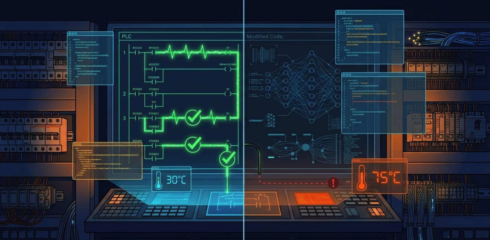

  

  

## ⚙️ Exploring the World of Industrial Automation & Intelligent Systems 

I'm interested in combining engineering principles, software development, and data-driven technologies to solve real-world industrial challenges.

### Automation | Python | Machine Learning | Industrial Control | Instrumentation

With a background in Electrical Engineering (Control), I'm continuously expanding my knowledge in programming, artificial intelligence, and industrial automation.

I enjoy learning through hands-on projects, exploring new technologies, and turning theoretical concepts into practical engineering solutions.

---

### 🚀 Technical Interests

- 🐍 **Python Programming** – Developing practical programming projects.
- 🤖 **Machine Learning** – Exploring data-driven models and intelligent systems.
- ⚙️ **PLC Programming** – Learning LAD / Ladder Logic using Siemens S7-300 and STEP 7 V5.7.
- 🏭 **Industrial Automation** – Exploring industrial control and automation systems.
- 📏 **Instrumentation** – Learning sensors, measurement, and process control.
- 🔌 **Industrial Control Systems** – Understanding the integration of industrial hardware and software.

### 🛠️ Technologies & Tools

**Programming**
- Python

**PLC & Automation**
- Siemens S7-300
- SIMATIC Manager
- STEP 7 V5.7
- LAD / Ladder Logic

**Other Areas**
- Machine Learning
- Instrumentation & Process Control
- Git & GitHub

### 🎯 Current Learning Focus

- Developing Python projects.
- Practicing PLC programming with Siemens S7-300.
- Learning Machine Learning fundamentals.
- Understanding industrial sensors and measurement systems.
- Exploring the connection between software and industrial automation.

### 📂 Featured Projects

My repositories will include practical projects, experiments, and technical documentation in:

- Python Programming
- Machine Learning
- PLC Programming
- Industrial Automation
- Instrumentation & Process Control

### 📫 Connect With Me

- GitHub: [@LakReza](https://github.com/LakReza)

---

⭐ *Learning by doing, building step by step, and improving every day.*
